<div align="center">


# MacToolbox

**四合一原生 macOS 菜单栏效率工具箱**

Finder `⌘X` 剪切 · 截图标注与 OCR · 划词即时翻译 · 剪贴板历史

[](https://github.com/Kiteflyingee/MacToolbox/releases/tag/v0.2.18)
[](#3-步快速开始)
[](https://github.com/Kiteflyingee/MacToolbox/releases/tag/v0.2.18)
[](LICENSE)
[](#从源码构建与开发文档)

**[⬇️ 下载通用安装包 DMG (v0.2.18)](https://github.com/Kiteflyingee/MacToolbox/releases/download/v0.2.18/MacToolbox-0.2.18-universal.dmg)** · **[📦 全部发行版](https://github.com/Kiteflyingee/MacToolbox/releases)** · **[🔐 屏幕录制权限指南](docs/屏幕录制权限.md)** · **[🛡️ 分发与构建说明](docs/分发与公证.md)**

</div>

---

> **项目说明**：MacToolbox 是基于 Swift 6 与 AppKit 开发的原生 macOS 菜单栏工具，采用 **MIT 协议** 开源，提供 Intel 与 Apple Silicon 双架构通用安装包。

## 为什么选择 MacToolbox

| ⚡ 纯原生超轻量 | 🔋 静默零轮询低功耗 |
| :--- | :--- |
| 使用 **Swift 6 + AppKit** 原生构建，无 Electron 运行时包袱，Intel + Apple Silicon 双架构通用 DMG 体积仅约 **4 MB**。 | Finder 与辅助功能均由 **事件通知驱动**，闲置时实测 CPU 为 **0.0%**，系统休眠、息屏与锁屏自动挂起采集。 |

| 🔒 本地存储与钥匙串安全 | 📖 MIT 开源可审计 |
| :--- | :--- |
| 剪贴板历史保存在本机 SQLite；翻译 API Key 存入 **系统钥匙串（Keychain）**，并自动登记摘要防止敏感密钥进入剪贴板记录。 | 全量源码以 **[MIT License](LICENSE)** 开源，零遥测、无云端账号绑定，支持本地自由审计、自定义修改与一键打包。 |

---

## 核心功能演示

### ✂️ Finder 原生 `⌘X` / `⌘V` 文件剪切

<p align="center">
  
</p>

- 在 Finder 中选中文件或文件夹后直接按 **`⌘X`** 标记剪切，切换到目标目录按 **`⌘V`** 即可移动（无需反复拖曳或借助第三方脚本）。
- **智能输入焦点避让**：重命名文件、使用搜索框或处于文本编辑焦点时，`⌘X` 自动保留系统原生文本剪切行为，避免误标记文件。
- **可控提示音**：支持在「偏好设置 → 通用」开关及试听 Finder 剪切就绪提示音，也可在菜单栏单独启停该模块。

---

### 📸 截图标注、屏幕取色与 OCR 截图翻译

<p align="center">
  
</p>

- **智能窗口识别与框选**：启动截图后自动高亮悬停窗口，支持自由框选、边缘微调及比例约束；可在「偏好设置 → 通用」自定义全局截图快捷键（点击录入、立即保存、支持清除与冲突提示，组合键需包含 `⌘` 或 `⌃`）。
- **完整原生标注工具栏**：提供指针移动、备注气泡、**步骤编号引线**（`1 / 2 / 3`）、8 种几何形状与多种填充样式、曲线/直线箭头、文字批注、聚光高亮、画笔与荧光笔、**马赛克 / 高斯模糊**（支持框选与画笔涂抹打码）以及 **局部放大镜**（`1.5x–4x`），支持 `⌘Z` / `⇧⌘Z` 撤销与重做。
- **像素级屏幕取色与一键 OCR 翻译**：支持取色器放大镜按 `C` 键直接复制指针像素色值；点击工具栏「翻译截图」按钮可离线提取选区文字并直接弹出译文浮窗。

---

### 🌐 划词 & 复制即时翻译（兼容 OpenAI 接口）

<p align="center">
  
</p>

- **无打扰浮窗体验**：鼠标划选文字或复制内容后在光标附近浮现轻量「翻译」胶囊，点击展开圆角毛玻璃译文卡片，支持快捷键关闭与一键「复制译文」。
- **自动语种路由与模型兼容**：内置语种识别（自动中英互译及目标语言切换），可对接任意兼容 **OpenAI Chat Completions** 协议的接口、模型与 Key（本机回环服务如本地部署模型可不填 Key）。
- **特殊场景说明**：WPS 等环境中如划词无响应，可手动复制文字触发翻译，或使用截图 OCR 翻译；应用不会自动模拟发送复制快捷键。

---

### 📋 菜单栏剪贴板历史（最近 20 条）

<p align="center">
  
</p>

- **最近 20 条一键回放**：菜单栏实时维护最近 **20** 条记录（文本摘要、图片缩略图与文件/文件夹条目），点击任意记录即可重新写入系统剪贴板供 `⌘V` 粘贴。
- **模块独立可控**：`Finder 剪切`、`划词翻译` 与 `剪贴板历史` 均可在菜单栏一键开启或暂停，按需使用不占冗余资源。

---

## 3 步快速开始

1. **下载并安装**  
   从 [v0.2.18 Release](https://github.com/Kiteflyingee/MacToolbox/releases/tag/v0.2.18) 下载 `MacToolbox-0.2.18-universal.dmg`（支持 **macOS 14 及以上**，兼容 Intel 与 Apple 芯片），双击打开后将 **`MacToolbox.app` 拖入 `Applications`**。  
   > 开源发行版采用 Ad-hoc 签名：若首次打开提示“无法验证开发者”，请在「应用程序」中右键（或按住 `Control` 点击）`MacToolbox.app` 选择「打开」，或在「系统设置 → 隐私与安全性」底部点击「仍要打开」。若正在运行旧版，请先从菜单栏退出后再替换。

2. **按分步引导授权权限**  
   打开后进入「偏好设置 → 权限」或直接触发功能，按指引授予以下系统权限：
   - **辅助功能**：用于 Finder `⌘X` 快捷键识别与辅助功能划词读取。
   - **隐私与安全性 → 录屏与系统录音**：用于截屏、像素取色与截图 OCR。列表未出现 `MacToolbox` 时，点击列表下方 **`＋`** 按钮选择 `/Applications/MacToolbox.app`（找不到可点引导中的「显示应用位置」），详细排查见 [屏幕录制权限说明](docs/屏幕录制权限.md)。

3. **配置截图快捷键与翻译服务**  
   在「偏好设置」设置惯用的截图快捷键、按需开启「开机自启动」，并填写兼容 Chat Completions 的 API 地址、模型名称与 API Key（点击「测试连接」验证后即可使用）。

<details>
<summary>📦 安装包 SHA-256 校验与隐私说明</summary>

- **校验安装包完整性**（下载同目录下提供 `.sha256` 文件）：
  ```sh
  shasum -a 256 -c MacToolbox-0.2.18-universal.dmg.sha256
  ```
- **架构与签名说明**：通用 DMG 包含 `arm64` 与 `x86_64` 双架构二进制，采用开源项目通用的 Ad-hoc 签名打包（自定义签名与公证流程见 [分发与公证说明](docs/分发与公证.md)）。
- **隐私边界**：划词、复制或截图 OCR 触发翻译的文本仅发送至你在设置中自行指定的翻译服务端，请留意所选服务商的隐私政策；API Key 仅保存于系统钥匙串，剪贴板历史仅存储在本地。

</details>

---

## 从源码构建与开发文档

需要 **Swift 6.0 或更新工具链** 与 **macOS 14 或以上**系统环境：

```sh
swift build
sh tools/test_core.sh
MACTOOLBOX_ADHOC_SIGN=1 sh tools/build_app.sh
```

- 构建与 DMG 打包脚本详见 [分发与公证说明](docs/分发与公证.md)；请勿将任何个人证书私钥、API Key 或本机签名配置提交到仓库。
- 完整原生测试需在正常登录的 macOS 桌面会话下运行。
- App Store 沙箱限制与适配说明见 [Mac App Store 上架说明](docs/Mac-App-Store上架说明.md)。

<details>
<summary>📝 版本更新记录</summary>

- **v0.2.18（2026-11-15）**
  - 修复bug

</details>

---

<div align="center">

基于 [MIT License](LICENSE) 开源 · 第三方工具栏图标许可与来源见 [Resources/Licenses/NOTICE.txt](Resources/Licenses/NOTICE.txt)

</div>
